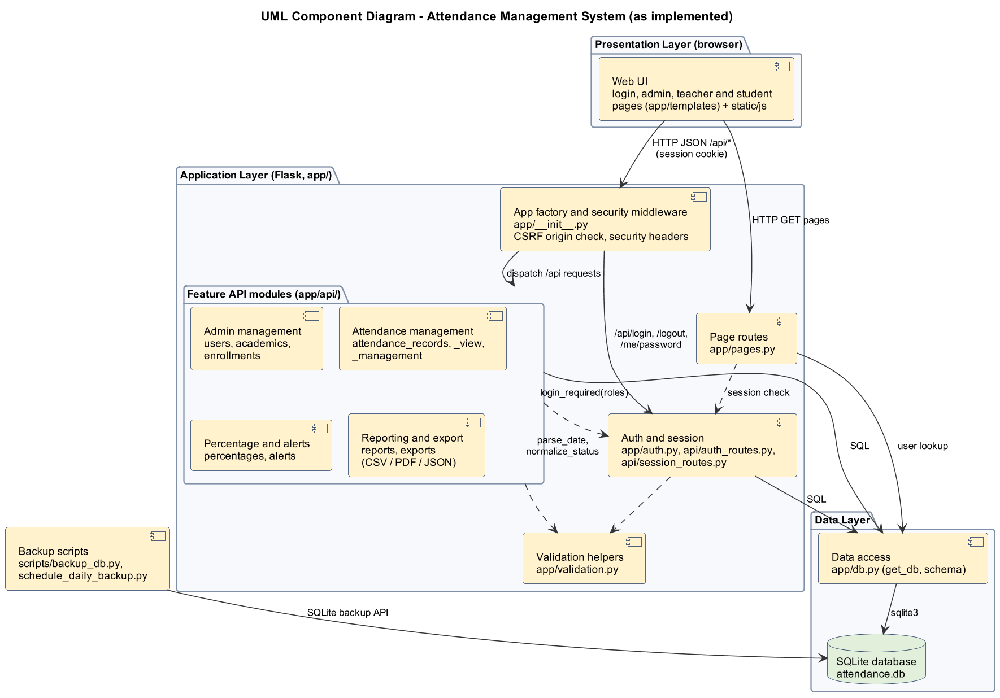
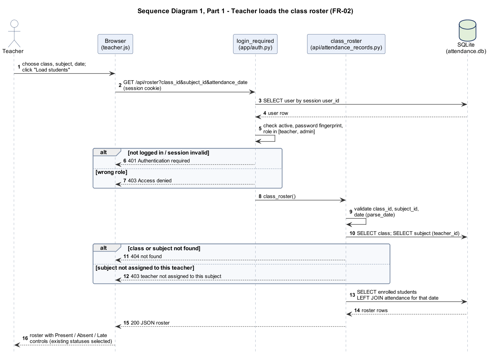
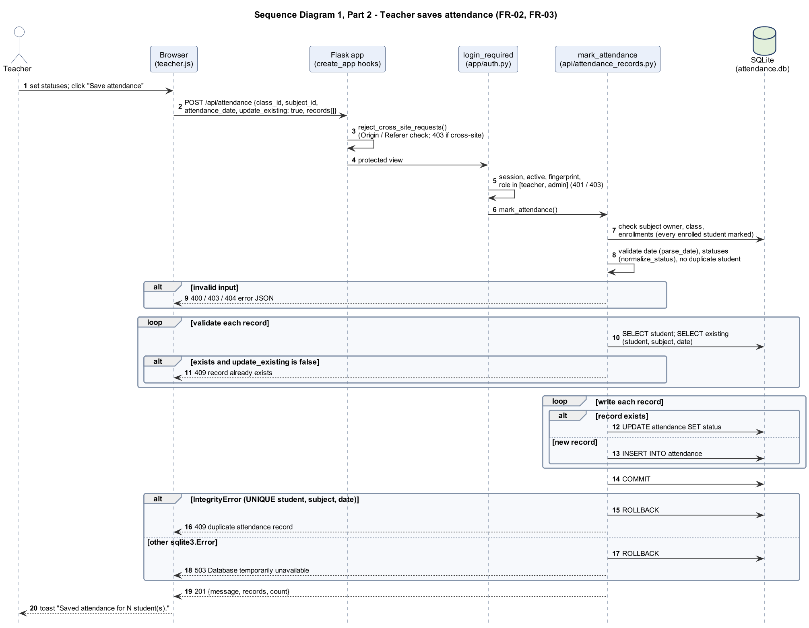
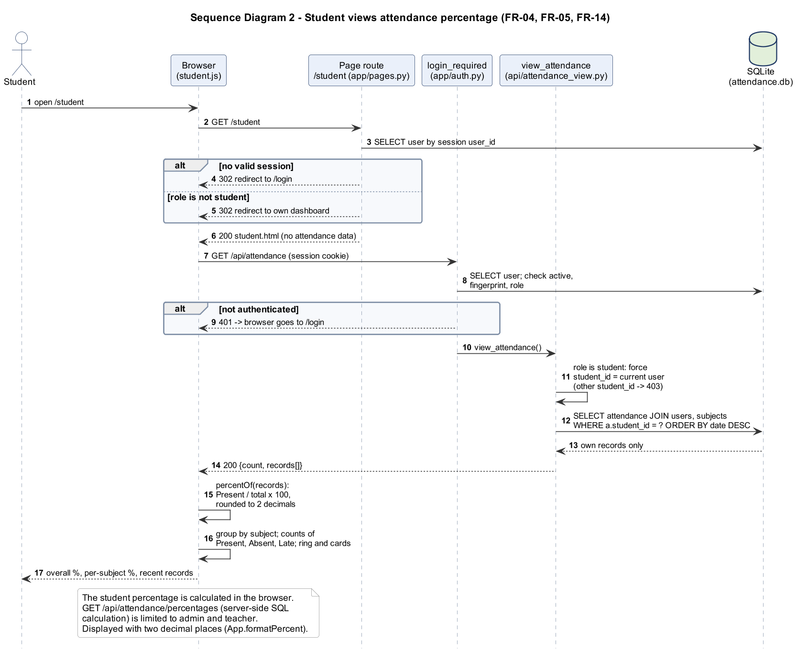
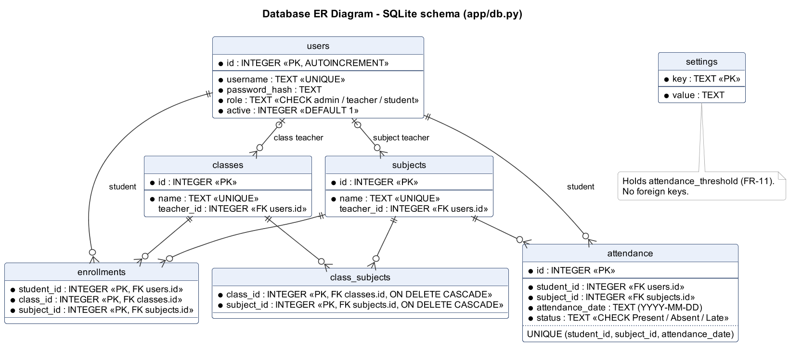
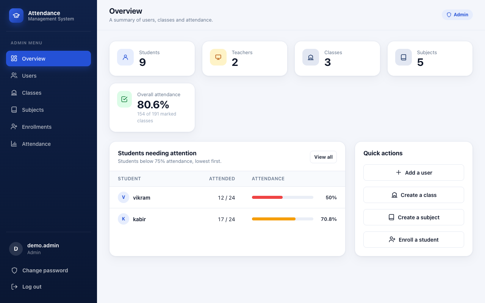
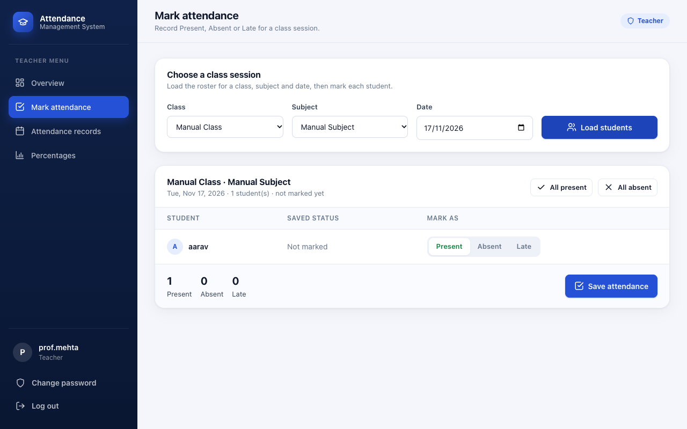
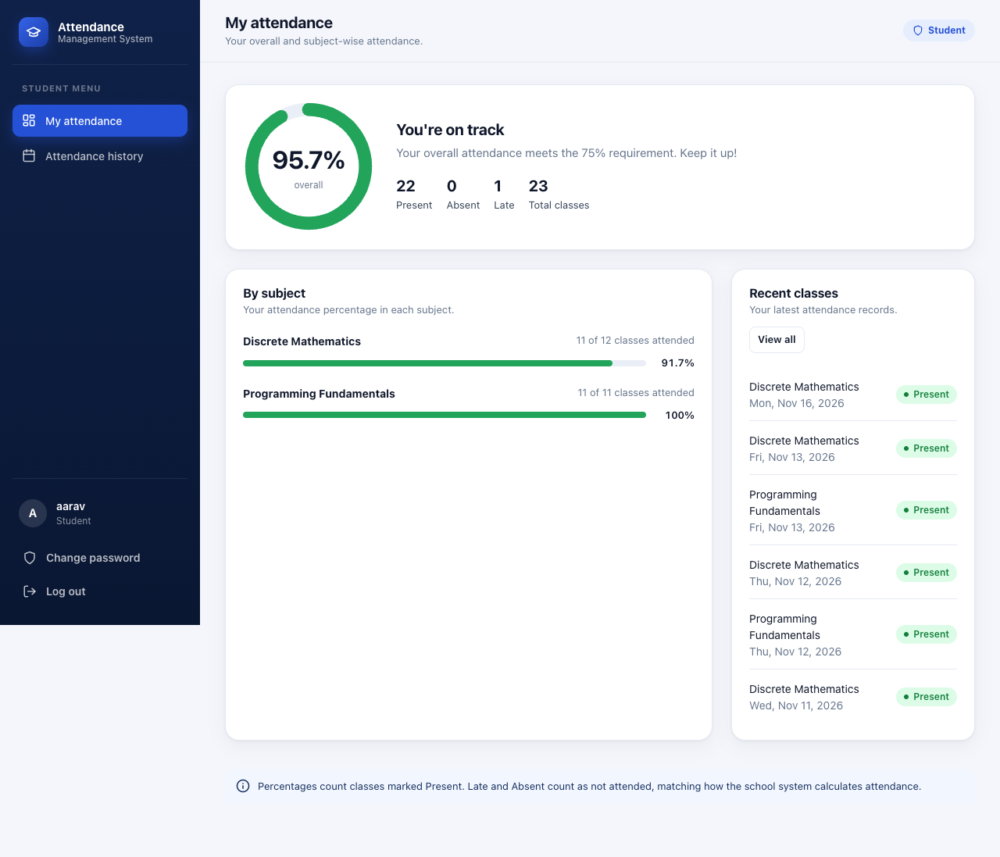

# Document Control {#document-control}

## Document Information

| Item | Value |
|---|---|
| Document | Software Architecture and Design (SAD) |
| System | Attendance Management System |
| Version | 2.1 |
| Date | 2026-11-17 |
| Team | Sumukh, Jagadeesh, Tharith |
| Baseline | `Documents/SAD.pdf` (UML component diagram), `Documents/attendance_justification.pdf` |
| Status | Final draft, pending instructor approval |

## Revision History

| Version | Date | Description | Prepared by |
|---|---|---|---|
| 1.0 | 2026-10-15 (in repository by this date) | Layered UML component diagram (`Documents/SAD.pdf`) and architecture pattern justification (`attendance_justification.pdf`) | Project team |
| 2.0 | 2026-11-17 | Complete design document based on the implemented code: new component diagram, component design, two sequence diagrams, interface and API design, database design with ER diagram, security architecture, error handling, UI design, requirement mapping, decisions and deviations | Sumukh, Jagadeesh, Tharith |
| 2.1 | 2026-11-17 | Reports screen and export controls, two-decimal percentage display, phone table layout, D-01 resolution (upstream WebKit), updated deviations and risks. | Sumukh, Jagadeesh, Tharith |

## Approval Status

| Role | Name | Decision | Date |
|---|---|---|---|
| Course instructor | Pending | Pending approval | Pending |
| Team review | Sumukh, Jagadeesh, Tharith | Pending review | Pending |

[[TOC]]

# 1. Introduction {#introduction}

## 1.1 Purpose

This document describes the architecture and detailed design of the Attendance Management System as implemented in the repository. It explains how the requirements of the SRS (`Documents/SRS_Final.pdf`) are realised by components, interfaces and data structures, and where the implementation differs from the version 1.0 design.

## 1.2 Scope

The document covers the Flask application (`app/`), the browser user interface (`app/templates/`, `app/static/`), the SQLite database (`app/db.py`) and the operational scripts for backups (`scripts/backup_db.py`, `scripts/schedule_daily_backup.py`). Test tooling is described in the Test Plan.

## 1.3 Intended Audience

Course instructor and evaluators, the development team, testers, and future maintainers.

## 1.4 Definitions

| Term | Meaning |
|---|---|
| Blueprint | Flask mechanism for grouping routes; the API uses one blueprint `api` mounted at `/api` |
| View function | Python function that handles one route |
| `login_required(roles)` | Decorator in `app/auth.py` that enforces authentication and role checks |
| Session fingerprint | HMAC of the user's password hash stored in the session to invalidate old sessions |
| Roster | List of students enrolled in a class for a subject, with their status for a date |
| Component | Group of modules with one responsibility (section 4) |
| Other terms | See SRS section 1.4 |

## 1.5 References

| Reference | Location |
|---|---|
| SRS v2.0 | `Documents/SRS_Final.pdf` |
| Test Plan v2.0 | `Documents/Test_Plan_Final.pdf` |
| SAD v1.0 | `Documents/SAD.pdf` |
| Architecture justification | `Documents/attendance_justification.pdf` |
| Maintainability notes | `docs/NFR06_MAINTAINABILITY.md` |
| Compatibility notes | `docs/NFR05_COMPATIBILITY.md` |
| Backup notes | `docs/NFR03_BACKUPS.md` |
| Diagram sources (PlantUML) | `Documents/diagrams/source/` |
| IEEE 1016-2009 | Software Design Descriptions (structure followed) |

# 2. Architecture Overview {#architecture-overview}

## 2.1 Architecture Goals

| Goal | Driver |
|---|---|
| Correct, non-duplicated attendance data | FR-03, FR-04, NFR-03 |
| Strict role separation for every request | FR-01, NFR-01 |
| Pages and data within 3 seconds | NFR-02 |
| Features changeable independently | NFR-06 |
| Works in modern browsers without plugins | NFR-05 |
| Simple to run for one institution | Scope (SRS 2.5) |

## 2.2 Design Constraints

Python and Flask; SQLite single-file database; one application server; browser pages restricted to same-origin scripts and styles by the Content Security Policy; no production code changes after Deliverable 3 without approval; Optional Sprint 3 skipped.

## 2.3 Architecture Style

The system follows a **layered architecture** deployed as a web application (the pattern chosen in `attendance_justification.pdf`):

1. **Presentation layer** (browser): HTML templates rendered once per page, plus JavaScript that loads all data from the API and renders it.
2. **Application layer** (Flask): security middleware, page routes, authentication and session handling, feature API modules, validation helpers.
3. **Data layer**: data-access helper `get_db()` and the SQLite database.

Each layer calls only the layer below it. The browser never accesses the database; every data request passes through `login_required` in the application layer.

## 2.4 Major Components and Interactions

The application factory `create_app()` (`app/__init__.py`) configures the application, creates the schema, registers the API blueprint at `/api` and the page blueprint at `/`, and adds two request hooks: a cross-site request check before state-changing requests and security headers on every response. Page routes (`app/pages.py`) return the HTML shell of a dashboard after checking the session. The dashboard JavaScript calls JSON endpoints; each endpoint is protected by `login_required`, validates its input with helpers from `app/validation.py`, and reads or writes SQLite through `get_db()`.

## 2.5 Technology Stack

| Layer | Technology |
|---|---|
| Browser UI | HTML5 templates (Jinja2), CSS (`app/static/css/app.css`), vanilla JavaScript (`common.js`, `admin.js`, `teacher.js`, `student.js`, `login.js`) |
| Web framework | Flask (Werkzeug routing, signed-cookie sessions, password hashing) |
| Language | Python 3.11+ |
| Database | SQLite 3 through the standard `sqlite3` module |
| Exports | Python `csv` module; PDF generated in-process (`app/api/exports.py`) |
| Operations | `scripts/backup_db.py` (SQLite backup API), `scripts/schedule_daily_backup.py` (cron) |
| Testing and CI | pytest, Playwright, Coverage.py, GitHub Actions (`.github/workflows/tests.yml`) |

## 2.6 Architectural Decisions and Trade-offs

| Decision | Rationale | Trade-off |
|---|---|---|
| Layered monolith instead of microservices | One institution, three roles, one team; keeps attendance writes and percentage reads in one database and transaction | Scales as a whole; one server is a single point of failure |
| JSON API + client-rendered dashboards | One API serves all dashboards and tests; pages contain no data, so page routes stay simple | Requires JavaScript; every screen makes several API calls |
| Authentication inside Flask (no external service) | Fewer moving parts; Werkzeug provides salted hashing | No single sign-on |
| SQLite | No server to install; transactions and constraints suffice for the load | Single writer at a time; not for multi-server deployment |
| Uniqueness enforced by the database | `UNIQUE(student_id, subject_id, attendance_date)` cannot be bypassed by any code path | Duplicate attempts surface as errors that the API must translate (409) |
| Session bound to password fingerprint | Changing a password or deactivating an account ends every other session without server-side session storage | User row is read on every request |

# 3. Architecture Diagram {#architecture-diagram}

The diagram shows only components that exist in the code. The version 1.0 diagram also contained an external **Security / Auth Service** (interface `IVerifyCredentials`, "HTTPS/token API") and an external **Report Engine** (`IReportEngine`). The code contains neither: credentials are checked by `api/auth_routes.py` with Werkzeug password hashes, and reports and exports are produced by `api/reports.py` and `api/exports.py`. Both remain documented as original design elements in [section 12](#decisions).

# 4. Component Design {#component-design}

## 4.1 Web UI

| Aspect | Description |
|---|---|
| Responsibility | Login page and three role dashboards; renders data, collects input, shows confirmations, toasts and empty or error states; on phones (max 640 px) tables become labelled cards (`data-label` set by `App.fillRows`) |
| Inputs | User actions; JSON responses from `/api` |
| Outputs | HTTP requests to `/api` with the session cookie; rendered tables, cards and dialogs |
| Dependencies | Page routes (HTML shell), API endpoints |
| Interfaces | `App.api(path, {method, body})` in `common.js` (redirects to `/login` on 401); `App.initSections` for hash navigation |
| Requirements | FR-01 to FR-05, FR-07 to FR-11, FR-13 to FR-15, NFR-04, NFR-05 |
| Error conditions | Network failure ("Unable to reach the server"); 401 -> login page; other errors shown as toasts or in dialogs |
| Files | `app/templates/*.html`, `app/static/js/*.js` (`common.js`, `admin.js`, `teacher.js`, `student.js`, `login.js`, `reports.js`), `app/static/css/app.css` |

## 4.2 App Factory and Security Middleware

| Aspect | Description |
|---|---|
| Responsibility | Configuration, schema creation, blueprint registration, threshold loading, CSRF origin check, security headers, static MIME types |
| Inputs | Environment (`FLASK_SECRET_KEY`, `FLASK_COOKIE_SECURE`), optional test configuration, every HTTP request |
| Outputs | Configured Flask app; 403 for cross-site state-changing requests; headers on all responses |
| Dependencies | `app/db.py`, `app/pages.py`, `app/api` |
| Interfaces | `create_app(test_config=None)`; hooks `reject_cross_site_requests`, `add_security_headers`, `force_js_content_type` |
| Requirements | NFR-01, NFR-05, NFR-06 |
| Error conditions | Cross-site POST/PUT/PATCH/DELETE -> 403 "Cross-site request rejected" |
| Files | `app/__init__.py` |

## 4.3 Authentication and Session

| Aspect | Description |
|---|---|
| Responsibility | Login, current-user lookup, password change, logout, role checks, session lifetime and invalidation |
| Inputs | Username/password JSON; session cookie |
| Outputs | Session with `user_id` and password fingerprint; `g.current_user` for views; 401/403 responses |
| Dependencies | `get_db()`, Werkzeug hashing, `app/validation.py` |
| Interfaces | `POST /api/login`, `GET /api/me`, `POST /api/me/password`, `POST /api/logout`; decorator `login_required(allowed_roles=None)`; `start_user_session()`, `session_matches_password()` |
| Requirements | FR-01, FR-13, FR-15, NFR-01 |
| Error conditions | 400 missing fields; 401 invalid credentials, expired or invalidated session; 403 wrong role; 503 database unavailable |
| Files | `app/auth.py`, `app/api/auth_routes.py`, `app/api/session_routes.py`, `app/pages.py` (page-level checks) |

## 4.4 Admin Management

| Aspect | Description |
|---|---|
| Responsibility | User accounts; classes, subjects, class-subject links and teacher assignment; enrollments |
| Inputs | Admin JSON requests |
| Outputs | Created/updated rows; lists for the admin dashboard |
| Dependencies | Auth (`login_required(["admin"])`), `get_db()`, validation constants |
| Interfaces | `/api/users[...]`, `/api/classes[...]`, `/api/subjects[...]`, `/api/enrollments`; `/api/teacher/classes` and `/api/teacher/subjects` for teachers |
| Requirements | FR-07, FR-08, FR-09 |
| Error conditions | 400 invalid fields; 404 unknown IDs; 409 duplicate username, class or subject name, or enrollment |
| Files | `app/api/users.py`, `app/api/academics.py`, `app/api/enrollments.py` |

## 4.5 Attendance Management

| Aspect | Description |
|---|---|
| Responsibility | Class roster, attendance marking (single and batch), update, deletion, role-scoped viewing and filtering |
| Inputs | Class, subject, date, status, filters |
| Outputs | Roster JSON; saved records; filtered record lists |
| Dependencies | Auth, validation (`parse_date`, `normalize_status`), `get_db()` |
| Interfaces | `GET /api/roster`, `POST /api/attendance`, `GET /api/attendance`, `PUT /api/attendance`, `GET/PUT/PATCH/DELETE /api/attendance/<id>` |
| Requirements | FR-02, FR-03, FR-05, FR-10 |
| Error conditions | 400 invalid status/date/missing students; 403 subject of another teacher or another student's data; 404 unknown entities; 409 duplicates; 503 database errors (with rollback) |
| Files | `app/api/attendance_records.py`, `app/api/attendance_view.py`, `app/api/attendance_management.py` |

## 4.6 Percentage and Alerts

| Aspect | Description |
|---|---|
| Responsibility | Attendance percentages per student (optionally per subject); students below the threshold; threshold storage |
| Inputs | Optional `subject_id`, `student_id`, `class_id`, `threshold` |
| Outputs | `{count, students[]}` with `classes_attended`, `total_classes`, `attendance_percentage`; alert lists with `threshold` |
| Dependencies | Auth, `get_db()`, `settings` table |
| Interfaces | `GET /api/attendance/percentages` (admin, teacher); `GET/POST /api/attendance/alerts` and aliases; `GET /api/attendance/threshold`; `POST/PUT /api/attendance/threshold` (admin) |
| Requirements | FR-04, FR-11, FR-14 |
| Error conditions | 400 invalid IDs or threshold; 403 out-of-scope subject or student; 404 unknown subject; 503 database error |
| Files | `app/api/percentages.py`, `app/api/alerts.py`; student-side calculation in `app/static/js/student.js` (`percentOf`) |

Calculation: `percentage = round(classes_attended / total_classes * 100, 2)` where `classes_attended` counts `Present` only and `total_classes` counts Present, Absent and Late; 0.0 when there are no records. The dashboards format values with `App.formatPercent`, which rounds half away from zero and always shows two decimal places (83.33%, 100.00%); the earlier one-decimal display (defect MV-02) was fixed in the regression run.

## 4.7 Reporting and Export

| Aspect | Description |
|---|---|
| Responsibility | Attendance reports by student, class, subject and date range; CSV, PDF and JSON export |
| Inputs | Scope in the path or query; `start_date`, `end_date`; export format |
| Outputs | Report JSON; file download with `Content-Disposition: attachment` |
| Dependencies | Auth (`login_required()` with role scoping in `_build_attendance_report_data`), `get_db()` |
| Interfaces | `GET /api/reports/attendance[/student/<id>, /class/<id>, /subject/<id>]`, aliases `/api/attendance/report(s)`; `.../export[/<format>]` |
| Requirements | FR-06, FR-12 |
| Error conditions | 400 invalid scope, dates or unsupported format; 403 out of scope; 404 unknown entity |
| Files | `app/api/reports.py`, `app/api/exports.py` |

The Reports screen (`app/static/js/reports.js`, loaded by the administrator and teacher dashboards) calls these endpoints: it builds the query from the selected filters, shows the summary and records, and exports the displayed report with the same filters. Downloads use `fetch` so that HTTP errors and empty reports are shown as messages instead of being downloaded. Gaps G-01 and G-02 (defects D-02, D-03) are closed.

## 4.8 Validation Helpers

| Aspect | Description |
|---|---|
| Responsibility | Shared constants and pure functions: valid statuses and roles, minimum password length, status normalisation, date parsing, encodability check |
| Interfaces | `VALID_STATUSES`, `VALID_ROLES`, `MIN_PASSWORD_LENGTH`, `normalize_status()`, `parse_date()`, `_is_encodable()` |
| Requirements | FR-02, FR-03, FR-13, NFR-01 |
| Files | `app/validation.py` |

## 4.9 Data Access and Database

| Aspect | Description |
|---|---|
| Responsibility | Schema creation and migration; one SQLite connection per request (`flask.g`) with `PRAGMA foreign_keys = ON`; closing the connection after the request |
| Interfaces | `get_db()`, `init_db(app)`, `SCHEMA` |
| Requirements | FR-03, NFR-02, NFR-03 |
| Files | `app/db.py` |

## 4.10 Backup Scripts

| Aspect | Description |
|---|---|
| Responsibility | Consistent backups with the SQLite backup API and `PRAGMA integrity_check`; install, show and remove a daily cron entry |
| Interfaces | `python scripts/backup_db.py`; `python scripts/schedule_daily_backup.py --show, --install, --remove` |
| Requirements | NFR-03 |
| Limitations | No restore script (gap G-07) |
| Files | `scripts/backup_db.py`, `scripts/schedule_daily_backup.py`, `docs/NFR03_BACKUPS.md` |

# 5. UML Sequence Diagrams {#sequence-diagrams}

## 5.1 Teacher Marks Attendance

Sequence diagram 1 is drawn in two parts so that it stays readable on an A4 page: Part 1 loads the roster, Part 2 saves the attendance. Together they form one complete flow (Teacher -> Browser -> Flask route -> authorization -> database -> response).

The roster request and the save request are two separate HTTP calls. Both pass through `login_required`; the save request also passes the cross-site origin check. `mark_attendance` validates the whole batch (subject ownership, date, statuses, complete enrollment, existing records) before writing, then writes all records in one transaction; any database error rolls back the whole batch.

## 5.2 Student Views Attendance Percentage

This reflects the real implementation: the student dashboard calculates the percentage in the browser from the student's own records returned by `GET /api/attendance`. The server-side calculation (`GET /api/attendance/percentages`) uses the same formula but is restricted to administrators and teachers.

# 6. API and Interface Design {#api-design}

## 6.1 Interface: Authentication (`POST /api/login`)

| Item | Specification |
|---|---|
| Route / function | `POST /api/login` -> `app/api/auth_routes.py::login` |
| Authorization | Public |
| Request | `Content-Type: application/json`; body `{"username": "...", "password": "..."}` |
| Validation | Body must be a JSON object; username a non-empty string (trimmed); password a non-empty string |
| Success response | `200 {"message": "Login successful", "user": {"id", "username", "role"}}` and a session cookie |
| Error responses | `400` "JSON request body required" / "Username and password are required"; `401` "Invalid username or password" (unknown user, wrong password, inactive); `503` "Authentication temporarily unavailable" |
| Requirements | FR-01, NFR-01 |

## 6.2 Interface: Mark Attendance (`POST /api/attendance`)

| Item | Specification |
|---|---|
| Route / function | `POST /api/attendance` -> `app/api/attendance_records.py::mark_attendance` |
| Authorization | `login_required(["teacher", "admin"])`; a teacher only for subjects with `teacher_id` = own ID |
| Request (batch, used by the UI) | `{"class_id": 1, "subject_id": 2, "attendance_date": "2026-11-16", "update_existing": true, "records": [{"student_id": 5, "status": "Present"}]}` |
| Request (single) | `{"student_id", "subject_id", "attendance_date", "status", "class_id"?, "update_existing"?}` |
| Validation | Status Present/Absent/Late (case-insensitive); date `YYYY-MM-DD`; subject, class and students exist; students have role student and are enrolled; with class and subject, every enrolled student must be submitted; no duplicate student in one batch |
| Success response | `201 {"message", "records": [...], "count"}` (batch); `201` or `200` with `record` (single new/updated) |
| Error responses | `400` validation; `403` subject of another teacher; `404` subject, class or student not found; `409` record exists and updates not allowed, or integrity violation; `503` database error (rolled back) |
| Requirements | FR-02, FR-03 |

## 6.3 Interface: View Attendance (`GET /api/attendance`)

| Item | Specification |
|---|---|
| Route / function | `GET /api/attendance` -> `app/api/attendance_view.py::view_attendance` |
| Authorization | `login_required(["admin", "teacher", "student"])`; students forced to their own ID; teachers limited to their subjects |
| Parameters | `subject_id`, `student_id`, `class_id`, `attendance_date`, `start_date`/`from_date`, `end_date`/`to_date`, `status` |
| Validation | Positive integers; dates `YYYY-MM-DD`; `start_date` not after `end_date`; status non-empty |
| Success response | `200 {"count": n, "records": [{"id", "attendance_id", "student_id", "student_name", "subject_id", "subject_name", "attendance_date", "status"}]}` newest first |
| Error responses | `400` invalid parameter; `403` other student's records or another teacher's subject; `404` unknown subject, student or class; `503` database error |
| Requirements | FR-05, FR-10, NFR-01 |

## 6.4 Interface: Attendance Percentages (`GET /api/attendance/percentages`)

| Item | Specification |
|---|---|
| Route / function | `GET /api/attendance/percentages` -> `app/api/percentages.py::attendance_percentages` |
| Authorization | `login_required(["admin", "teacher"])` |
| Parameters | Optional `subject_id` (teachers: own subjects only) |
| Success response | `200 {"count", "students": [{"student_id", "student_name", "classes_attended", "total_classes", "attendance_percentage"}]}` |
| Error responses | `400` invalid subject ID; `403` teacher not assigned; `404` subject not found; `503` database error |
| Requirements | FR-04 |

## 6.5 Internal Interface: `login_required(allowed_roles=None)`

| Item | Specification |
|---|---|
| Location | `app/auth.py` |
| Behaviour | Reads `session["user_id"]`; loads the user; rejects missing, inactive or password-changed sessions (clears the session); checks the role list; stores the user in `g.current_user` |
| Returns | The wrapped view's response, or `401 Authentication required`, `403 Access denied`, `503 Database temporarily unavailable` |
| Requirements | FR-01, FR-13, NFR-01 |

## 6.6 Complete Route Table

Generated from Flask's route map (`app.url_map`) and the role list of each `login_required` decorator. Export routes with an explicit `/<format_name>` segment are omitted for brevity; they share the view and roles of the route without it. `GET /api/attendance` appears twice: the first registration (`view_attendance`) handles every request; `get_attendance` is never reached (observation O-02).

Table 1: API routes

[[DATA:api_routes]]

Page routes (not under `/api`): `GET /login`, `GET /dashboard` (redirect by role), `GET /admin`, `GET /teacher`, `GET /student` (redirect to `/login` without a session, or to the user's own dashboard for another role), `GET /` (placeholder JSON, observation O-03) and `/static/<path>`.

# 7. Database Design {#database-design}

## 7.1 SQLite Architecture

One SQLite file (`attendance.db` by default, `DATABASE` configuration key). `init_db()` creates all tables and indexes with `CREATE ... IF NOT EXISTS` and adds missing columns for older files. Each request opens one connection (`get_db()`), enables foreign keys, sets `synchronous = NORMAL`, a 64 MB page cache and in-memory temporary storage, and closes it at the end of the request.

## 7.2 ER Diagram

## 7.3 Tables

Table 2: Tables, keys and constraints

| Table | Primary key | Foreign keys | Other constraints | Purpose |
|---|---|---|---|---|
| `users` | `id` (autoincrement) | - | `username` UNIQUE NOT NULL; `role` CHECK in (admin, teacher, student); `active` DEFAULT 1 | Accounts of all roles |
| `classes` | `id` | `teacher_id` -> `users.id` | `name` UNIQUE | Classes and class teacher |
| `subjects` | `id` | `teacher_id` -> `users.id` | `name` UNIQUE | Subjects and the teacher who marks them |
| `class_subjects` | (`class_id`, `subject_id`) | -> `classes.id`, -> `subjects.id` (ON DELETE CASCADE) | - | Subjects taught in a class |
| `enrollments` | (`student_id`, `class_id`, `subject_id`) | -> `users.id`, `classes.id`, `subjects.id` | - | Student enrolled in a class for a subject |
| `attendance` | `id` | `student_id` -> `users.id`; `subject_id` -> `subjects.id` | UNIQUE(`student_id`, `subject_id`, `attendance_date`); `status` CHECK in (Present, Absent, Late) | One status per student, subject and date |
| `settings` | `key` | - | `value` NOT NULL | Key-value settings (`attendance_threshold`) |

Indexes: `attendance(subject_id, attendance_date)`, `attendance(student_id, attendance_date)`, `attendance(attendance_date)`, `attendance(status)`, `enrollments(class_id, student_id)`, `enrollments(subject_id, student_id)`, `users(role)`, `classes(teacher_id)`, `subjects(teacher_id)`, `class_subjects(subject_id)`.

## 7.4 Preventing Duplicate Attendance

Duplicates are prevented at three levels:

1. **Database:** `UNIQUE(student_id, subject_id, attendance_date)` on `attendance`; any insert that would create a second record raises `sqlite3.IntegrityError`.
2. **Application:** before writing, `mark_attendance` looks up an existing record for each (student, subject, date). If one exists and the request did not allow updates, it returns `409`; if updates are allowed it issues `UPDATE ... SET status` on the existing row instead of inserting.
3. **Request:** a batch containing the same student twice for the same subject and date is rejected with `400`.

An `IntegrityError` caught during the write phase (for example two simultaneous saves) rolls back the whole transaction and returns `409`.

## 7.5 Data Access Patterns and Transactions

| Pattern | Where | Notes |
|---|---|---|
| Parameterised SQL only | All API modules | `?` placeholders; filters appended as fixed SQL fragments with bound values |
| Aggregation in SQL | `percentages.py`, `alerts.py` | `COUNT` and `SUM(CASE ...)` per student with `LEFT JOIN` so students without records appear with 0 |
| Role scoping in the query | `attendance_view.py`, `percentages.py` | `s.teacher_id = ?` for teachers, `a.student_id = ?` for students |
| Validate-then-write batch | `attendance_records.py` | All checks first, then all writes, one `commit()`; `rollback()` on error |
| Single-row writes | Users, classes, subjects, enrollments, corrections | `commit()` after the statement; `rollback()` on `sqlite3.Error` |

# 8. Security Architecture {#security-architecture}

Table 3: Security controls

| Area | Actual control | Limitation / recommendation |
|---|---|---|
| Password handling | Werkzeug salted hashes (`generate_password_hash`), verified with `check_password_hash`; hashes never returned by the API | 8-character minimum enforced on self-service change only (AF-01) - recommend applying `MIN_PASSWORD_LENGTH` in `users.py` |
| Authentication flow | `POST /api/login` -> session cleared and restarted (`start_user_session`) -> role redirect in `login.js` | No account lockout or rate limiting - recommended for deployment |
| Authorization | `login_required(roles)` on all API views except login and health; per-view data scoping; page routes redirect by role | Self-deactivation blocked only in the UI (AF-02) |
| Session security | Signed cookie; 30-minute lifetime refreshed on activity; HttpOnly; SameSite=Lax; password fingerprint invalidates other sessions; `Cache-Control: no-store` | Secure flag only with `FLASK_COOKIE_SECURE=1`; secret key random per start unless `FLASK_SECRET_KEY` is set (sessions end on restart) |
| CSRF | Rejects POST/PUT/PATCH/DELETE whose `Origin`/`Referer` is not the application's own origin | Requests without both headers are allowed (non-browser clients); no token-based CSRF |
| Database access | Only the server accesses SQLite; parameterised queries; foreign keys and CHECK constraints | Database file permissions are the host's responsibility |
| Input validation | `app/validation.py` and per-view checks; JSON bodies required | - |
| Browser protection | CSP `default-src 'self'; frame-ancestors 'none'`, `X-Frame-Options: DENY`, `nosniff`, `Referrer-Policy`; UI builds DOM with `textContent` only | D-01 (closed): WebKit 27.2 build r2370 logged false-positive `style-src-attr` violations for every `<select>` (upstream WebKit regression); build r2388 logs none. The policy was not relaxed |
| Export safety | CSV formula-injection neutralisation | - |
| Transport | Plain HTTP on the development server | HTTPS not implemented (G-08); deploy behind TLS and set `FLASK_COOKIE_SECURE=1` |

# 9. Error Handling and Logging {#error-handling}

## 9.1 Mechanism

Each API view validates its input and returns `jsonify(error=...)` with an HTTP status; there are no global error handlers, so unknown URLs and unsupported methods return Flask's default 404/405 responses. Database errors are caught (`sqlite3.Error`) and mapped to `503` with a generic message after `rollback()`; integrity violations map to `409`. The browser helper `App.api` turns non-2xx responses into error messages shown as toasts or inside dialogs, and redirects to `/login` on `401`.

Table 4: Expected behaviour for error conditions

| Condition | Server response | User-visible behaviour |
|---|---|---|
| Invalid credentials | `401` "Invalid username or password" | Error box on the login page; user stays on `/login` |
| Missing credentials | `400` (server) / client check | "Please enter both your username and password." |
| Not logged in / expired session | `401` "Authentication required"; pages redirect to `/login` | Browser goes to the login page |
| Wrong role | `403` "Access denied"; pages redirect to own dashboard | Own dashboard shown |
| Invalid attendance data | `400` with the field named (status, date, missing or unenrolled students) | Toast with the message; nothing saved |
| Duplicate record | `409` "Attendance record already exists..." / "Duplicate attendance record or integrity violation" | Toast; existing data unchanged |
| Database error | `503` "Database temporarily unavailable" (rolled back) | Toast; user can retry |
| Missing record or entity | `404` "... not found" | Toast or error state |
| No matching data | `200` with an empty list | Empty-state message, e.g. "No matching records" |
| Cross-site state-changing request | `403` "Cross-site request rejected" | Request blocked |

## 9.2 Logging

The application does not configure Python logging and writes no audit log. Request logs are produced only by the Werkzeug development server on the console. The backup cron entry appends to `backup.log`. An audit log of attendance changes is not implemented and is recommended for production.

# 10. User Interface Design {#ui-design}

All dashboards share one layout: a sidebar with the role menu, Change password and Log out; a title bar; and content sections switched by hash navigation (`#overview`, `#mark`, ...). On narrow screens the sidebar opens from a menu button. Destructive actions use a confirmation dialog; results are reported with toasts.

## 10.1 Administrator Workflow

Overview (counts, overall attendance, students needing attention) -> Users (create, search, filter, edit, deactivate/activate) -> Classes (create, assign class teacher, manage subjects) -> Subjects (create, assign teacher) -> Enrollments (enroll, search, filter, remove) -> Attendance (percentages; records with student search, subject, class, date, From/To and status filters and Clear filters) -> Reports (generate by student, class, subject, date range and status; export CSV / PDF / JSON).

## 10.2 Teacher Workflow

Overview (assigned subjects, classes, students tracked, average, students needing attention) -> Mark attendance (class, subject, date, Load students, set statuses, Save) -> Attendance records (search, subject, class, date, From/To and status filters, Clear filters, Correct status, Delete) -> Percentages (per subject) -> Reports (own subjects only; export CSV / PDF / JSON).

## 10.3 Student Workflow

My attendance (overall percentage ring, Present/Absent/Late/total, per-subject progress, recent records) -> Attendance history (subject, status and date filters).

Screenshots come from `docs/evidence/manual_validation_automation/screenshots/` and show demonstration data only.

# 11. Requirements-to-Component Mapping {#requirements-mapping}

Table 5: Requirements mapped to components

| Requirement | Component(s) | Main files |
|---|---|---|
| FR-01 | Auth and session; Page routes | `app/auth.py`, `app/api/auth_routes.py`, `app/pages.py` |
| FR-02 | Attendance management; Web UI | `app/api/attendance_records.py`, `teacher.js` |
| FR-03 | Attendance management; Database | `attendance_records.py`, `attendance_management.py`, `app/db.py` |
| FR-04 | Percentage and alerts; Web UI | `app/api/percentages.py`, `student.js` |
| FR-05 | Attendance management; Web UI | `app/api/attendance_view.py` |
| FR-06 | Reporting and export; Web UI Reports screen | `app/api/reports.py`, `static/js/reports.js` |
| FR-07 | Admin management | `app/api/users.py`, `admin.js` |
| FR-08 | Admin management | `app/api/academics.py`, `admin.js` |
| FR-09 | Admin management | `app/api/enrollments.py`, `admin.js` |
| FR-10 | Attendance management; Web UI | `attendance_view.py` filters; dashboard toolbars |
| FR-11 | Percentage and alerts | `app/api/alerts.py`; overview tables |
| FR-12 | Reporting and export; Web UI export buttons | `app/api/exports.py`, `reports.py`, `static/js/reports.js` |
| FR-13 | Auth and session | `auth_routes.py::change_password`, `common.js` |
| FR-14 | Web UI; Percentage and alerts | `admin.js`, `teacher.js`, `student.js` |
| FR-15 | Auth and session | `session_routes.py::logout`, `common.js` |
| NFR-01 | Security middleware; Auth and session | `app/__init__.py`, `app/auth.py` |
| NFR-02 | Database (indexes); aggregate queries | `app/db.py`, `percentages.py` |
| NFR-03 | Database transactions; Backup scripts | API write paths, `scripts/backup_db.py` |
| NFR-04 | Web UI | templates, `app.css` |
| NFR-05 | Web UI; Security middleware (MIME types) | `common.js` polyfills, `app/__init__.py` |
| NFR-06 | All (module structure) | `app/api/__init__.py`, `tests/test_nfr06_maintainability.py` |

# 12. Architecture Decisions, Risks and Deviations {#decisions}

## 12.1 Deviations from the Version 1.0 Design

Table 6: Planned design versus implementation

| Version 1.0 design | Implementation | Assessment |
|---|---|---|
| External Security / Auth Service via `IVerifyCredentials` ("HTTPS/token API") | Credentials verified in `api/auth_routes.py` with Werkzeug hashes; cookie sessions, no tokens | Simpler; the external service was never built. Documented as an original design component only. |
| External Report Engine via `IReportEngine` | Reports and CSV/PDF/JSON exports generated in-process (`reports.py`, `exports.py`) | Never built; in-process generation meets FR-06/FR-12 at the API level. |
| All client-server traffic over HTTPS | Plain HTTP development server; Secure-cookie switch only | Not implemented (G-08); deployment concern. |
| Percentage Calculator called by Attendance Manager after each save ("recalc request") | Percentages calculated on demand by SQL when requested; nothing is stored or recalculated on save | Avoids stale stored values. |
| Report Manager reachable from the Web UI | Reports screen with CSV / PDF / JSON export in the administrator and teacher dashboards | Implemented after Deliverable 3 testing (gaps G-01, G-02 and defects D-02, D-03 closed in the regression run). |
| Single database component | Same (SQLite), plus a `settings` table for the threshold | As planned. |

## 12.2 Risks and Unresolved Limitations

Table 7: Risks

| Risk / limitation | Impact | Mitigation |
|---|---|---|
| No HTTPS | Credentials and data readable on the network | Deploy behind TLS; set `FLASK_COOKIE_SECURE=1` |
| Single SQLite file and server | Single point of failure; limited concurrent writes | Daily verified backups; add a restore procedure (G-07) |
| Random secret key per start | All sessions end when the server restarts | Set `FLASK_SECRET_KEY` in deployment |
| Server-side password policy gap (AF-01) | Short passwords possible for admin-created accounts | Apply `MIN_PASSWORD_LENGTH` in `users.py` (needs approval) |
| No audit log | Changes to attendance cannot be traced to a user | Recommended for production |
| Untested browsers (Firefox, Edge, Safari) | Compatibility not proven | Run the NFR-05 suite on machines with these browsers |
