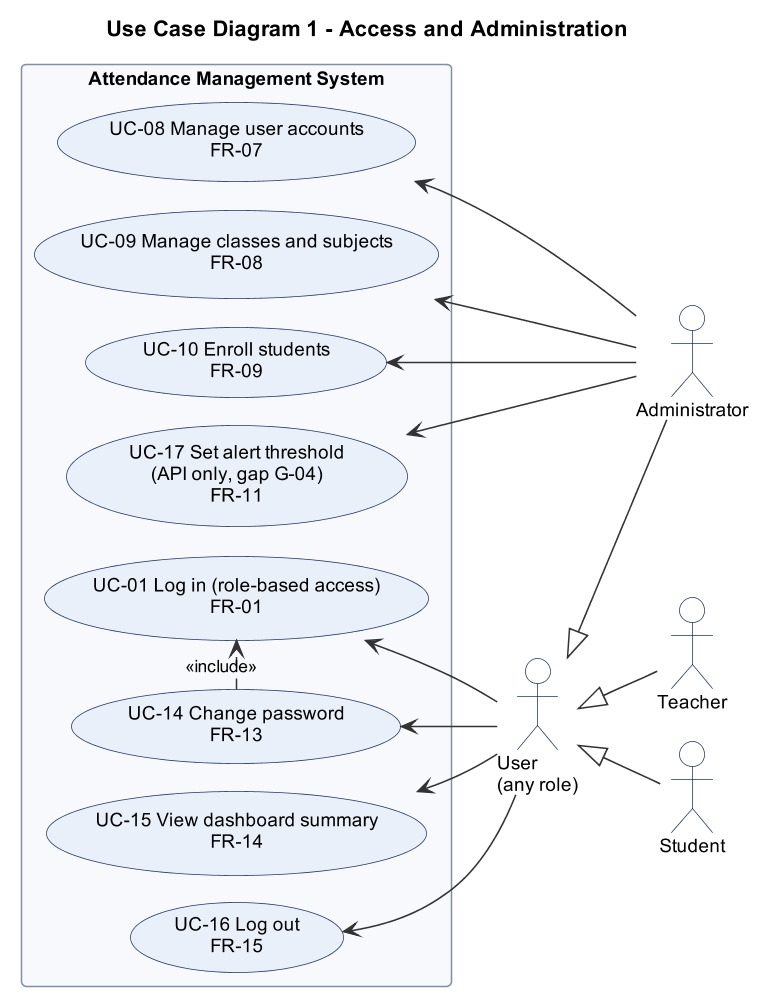
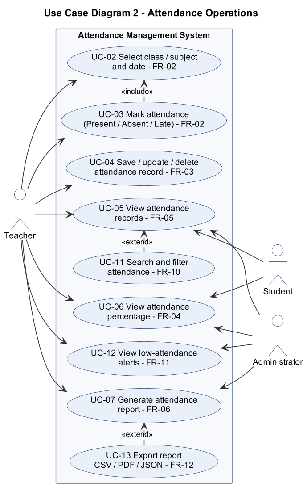

# Document Control {#document-control}

## Document Information

| Item | Value |
|---|---|
| Document | Software Requirements Specification (SRS) |
| System | Attendance Management System |
| Version | 2.1 |
| Date | 2026-11-17 |
| Team | Sumukh, Jagadeesh, Tharith |
| Baseline | `Documents/SRS.pdf` (version 1.0) |
| Status | Final draft, pending instructor approval |

## Revision History

| Version | Date | Description | Prepared by |
|---|---|---|---|
| 1.0 | 2026-10-15 (in repository by this date) | Original SRS: project description, FR-01 to FR-15 and NFR-01 to NFR-06 with priorities (`Documents/SRS.pdf`) | Project team |
| 2.0 | 2026-11-17 | Complete IEEE-style SRS: document control, introduction, overall description, detailed functional requirements, measurable non-functional requirements, security requirements, 17 use cases with two UML use-case diagrams, traceability matrix and appendices. Requirement IDs and statements unchanged; implementation status recorded separately. | Sumukh, Jagadeesh, Tharith |
| 2.1 | 2026-11-17 | Updated after the six failed test cases were fixed and re-verified (regression run): FR-04, FR-05, FR-06, FR-10, FR-12 and NFR-05 statuses and descriptions, use cases UC-07, UC-11 and UC-13, unresolved issues. Requirement IDs and statements unchanged. | Sumukh, Jagadeesh, Tharith |

## Review and Approval

| Role | Name | Decision | Date |
|---|---|---|---|
| Course instructor | Pending | Pending approval | Pending |
| Team review | Sumukh, Jagadeesh, Tharith | Pending review | Pending |

No approval has been recorded. This table will be completed when the document is reviewed.

[[TOC]]

# 1. Introduction {#introduction}

## 1.1 Purpose

This Software Requirements Specification (SRS) defines the functional, non-functional and security requirements of the Attendance Management System. It is the reference for the design (`Documents/SAD_Final.pdf`) and for testing (`Documents/Test_Plan_Final.pdf` and `docs/Test_Case_Document.md`). Each requirement keeps the identifier and statement from version 1.0 and adds detail, acceptance criteria and the implementation status found in the code.

## 1.2 Scope

The Attendance Management System is a web application for one educational institution. Administrators manage user accounts, classes, subjects and enrollments; teachers record and correct daily attendance per subject; students view their own attendance. The system calculates attendance percentages, identifies students below an attendance threshold, and generates and exports attendance reports.

The implemented system is a Flask (Python) application with a SQLite database and browser dashboards for the three roles. Administrators and teachers generate and export attendance reports from a Reports screen in their dashboards. Optional Sprint 3 was skipped and is outside the scope of this version.

## 1.3 Intended Audience

| Reader | Use of this document |
|---|---|
| Course instructor and evaluators | Assess completeness, correctness and traceability of the requirements |
| Development team | Reference for what the system must do and what is still open |
| Testers | Source of acceptance criteria; traceability to test case IDs |
| Future maintainers | Understanding the intended behaviour and known deviations |

## 1.4 Definitions and Abbreviations

| Term | Meaning |
|---|---|
| Administrator (admin) | User role that manages accounts, classes, subjects and enrollments |
| Teacher | User role that marks and corrects attendance for assigned subjects |
| Student | User role that views their own attendance |
| Attendance record | One status (Present, Absent or Late) for one student, one subject and one date |
| Attendance percentage | Present records divided by all marked records (Present + Absent + Late) x 100 |
| Threshold | Percentage below which a student is reported in an alert (default 75%) |
| Enrollment | Assignment of a student to a class and a subject |
| API | Application Programming Interface; here the JSON REST endpoints under `/api` |
| CSRF | Cross-Site Request Forgery |
| CSP | Content Security Policy (HTTP response header) |
| FR / NFR | Functional / Non-Functional Requirement |
| RBAC | Role-Based Access Control |
| RTM | Requirements Traceability Matrix |
| UC | Use case |
| SRS / SAD | Software Requirements Specification / Software Architecture and Design document |
| UT / IT / SYS | Unit / Integration / System test case prefixes in the Test Case Document |

## 1.5 References

| Reference | Location |
|---|---|
| SRS version 1.0 | `Documents/SRS.pdf` |
| Original architecture diagram | `Documents/SAD.pdf`, `Documents/UML_Diagram.pdf` |
| Original use case flows UC-01 to UC-07 | `Documents/Use_Case_Flows.pdf` |
| Architecture pattern justification | `Documents/attendance_justification.pdf` |
| Original Test Plan (75 cases) | `Documents/Test_Plan.pdf` |
| Product backlog | `Documents/backlog/BACKLOG.md` |
| Software Architecture and Design v2.0 | `Documents/SAD_Final.pdf` |
| Test Plan v2.0 | `Documents/Test_Plan_Final.pdf` |
| Test Case Document v{{tcd_version}} (197 cases) | `docs/Test_Case_Document.md`, `docs/Test_Case_Document.xlsx` |
| System Validation Report | `docs/System_Validation_Report.md` |
| Documentation compliance audit | `docs/Documentation_Compliance_Audit.md` |
| IEEE 830-1998 / ISO/IEC/IEEE 29148 | Recommended practice for software requirements specifications (structure followed in this document) |

## 1.6 Document Overview

Section 2 describes the product and its environment. Section 3 details the 15 functional requirements and section 4 the 6 non-functional requirements. Section 5 states the security objectives and requirements. Section 6 lists the use cases with two UML use-case diagrams. Section 7 is the requirements traceability matrix. The appendices contain references, terminology, assumptions and unresolved issues.

# 2. Overall Description {#overall-description}

## 2.1 Product Perspective

The system is a self-contained web application. It replaces manual attendance registers and spreadsheets. It has no interfaces to other institutional systems.

- **Client:** a modern web browser showing a login page and one dashboard per role (administrator, teacher, student). Dashboards are HTML pages with JavaScript that call the REST API.
- **Server:** one Flask application that serves the pages, exposes the REST API under `/api`, enforces authentication and authorization, and performs all calculations and validation.
- **Data:** one SQLite database file (`attendance.db` by default) with users, classes, subjects, class-subject links, enrollments, attendance records and settings.
- **Operations:** command-line scripts for database backup and daily backup scheduling (`scripts/backup_db.py`, `scripts/schedule_daily_backup.py`) and for demonstration data (`scripts/seed_demo_data.py`).

The version 1.0 design named an external Security / Auth Service and an external Report Engine. Neither exists: credentials and reports are handled inside the Flask application (see the SAD, section 12).

## 2.2 Product Functions

| Area | Functions | Requirements |
|---|---|---|
| Access | Role-based login, session timeout, password change, logout | FR-01, FR-13, FR-15 |
| Administration | Manage accounts, classes, subjects, teacher assignments and enrollments | FR-07, FR-08, FR-09 |
| Attendance | Load class roster, mark Present/Absent/Late, update, delete, prevent duplicates | FR-02, FR-03 |
| Analysis | Attendance percentages, low-attendance alerts, dashboard summaries | FR-04, FR-11, FR-14 |
| Viewing | View, search and filter attendance records | FR-05, FR-10 |
| Reporting | Reports by student, class, subject or date range; CSV/PDF/JSON export (API) | FR-06, FR-12 |

## 2.3 User Classes and Characteristics

| User class | Characteristics | Main functions | Frequency |
|---|---|---|---|
| Administrator | Staff responsible for academic records; basic computer skills | Accounts, classes, subjects, enrollments, institution-wide attendance and alerts | Weekly; at term start |
| Teacher | Teaching staff; basic computer skills | Mark and correct attendance for assigned subjects, view records, percentages and alerts | Daily |
| Student | Enrolled learner | View own attendance overall and per subject, history, change password | Occasional |

Each account has exactly one role. Inactive (deactivated) accounts cannot sign in.

## 2.4 Operating Environment

| Item | Environment |
|---|---|
| Server runtime | Python 3.11 or later (CI uses 3.11; development used 3.13) with Flask (`requirements.txt`) |
| Database | SQLite 3 (Python standard library `sqlite3`) |
| Server OS | Any OS that runs Python; developed on macOS, tested in CI on Ubuntu (GitHub Actions) |
| Client | Current desktop or mobile browser with JavaScript enabled; tested in Google Chrome 157 and Playwright Chromium; Firefox, Edge and Safari results are listed in section 4.5 |
| Network | Local development server over HTTP on `127.0.0.1`; HTTPS requires deployment behind a TLS server (not provided) |

## 2.5 Design and Implementation Constraints

1. Implementation language Python with the Flask framework; data stored in SQLite.
2. Browser dashboards must work without plugins and load scripts and styles only from the application (`Content-Security-Policy: default-src 'self'`).
3. Passwords must never be stored in plain text.
4. Production code changes after Deliverable 3 testing need team approval; Optional Sprint 3 is not implemented.
5. Single institution, single application server, single database file (no clustering).

## 2.6 Assumptions and Dependencies

1. Each user has one account and one role, created by an administrator.
2. Attendance is recorded per subject per date; a class session is identified by subject and date.
3. A teacher marks attendance only for subjects assigned to them.
4. The machine hosting the database provides `cron` for scheduled backups.
5. HTTPS, if required, is provided by the deployment environment (reverse proxy or hosting platform).
6. Python packages listed in `requirements.txt` are available.

# 3. Functional Requirements {#functional-requirements}

Each requirement keeps its version 1.0 identifier and statement ("Original requirement"). The implementation status is separate: IMPLEMENTED (implemented and verified by passing tests), PARTIAL (part implemented or verified; the missing part is named), NOT IMPLEMENTED, or NOT VERIFIED. Test results come from `docs/Test_Case_Document.md` v{{tcd_version}}.

## 3.1 FR-01 Authentication and Role Management {#fr-01}

| Field | Specification |
|---|---|
| Original requirement | The system shall allow authorized users (Administrator, Teacher, and Student) to log in according to their assigned role. |
| Priority | High |
| Actors | Administrator, Teacher, Student |
| Preconditions | The user has an active account with a role. |
| Trigger | The user submits username and password on the login page. |
| Main behaviour | The system checks the password against the stored hash; on success it starts a session (30-minute inactivity lifetime) and opens the dashboard of the user's role. Protected pages and API calls check the session and the role on every request. |
| Expected outcome | The user sees only the dashboard and functions of their role. |
| Exceptions | Missing fields: HTTP 400 and a message on the login page. Wrong credentials or inactive account: HTTP 401 "Invalid username or password". Database unavailable: HTTP 503 with no technical details. Wrong role for a page: redirect to the user's own dashboard; wrong role for an API: HTTP 403. Expired session: HTTP 401 and redirect to login. |
| Acceptance criteria | AC1 valid credentials open the correct dashboard for each role; AC2 invalid or blank credentials are refused with a message; AC3 a student cannot open teacher or admin pages or APIs; AC4 an idle session expires after 30 minutes; AC5 a failed authentication shows no internal details. |
| Implementation status | IMPLEMENTED - {{tc:FR-01}}. |

## 3.2 FR-02 Attendance Marking {#fr-02}

| Field | Specification |
|---|---|
| Original requirement | The system shall allow teachers to select a class/subject and mark each student as Present, Absent, or Late for a specific date. |
| Priority | High |
| Actors | Teacher (an administrator may also use the API) |
| Preconditions | The teacher is logged in and assigned to the subject; students are enrolled in the class and subject. |
| Trigger | The teacher chooses class, subject and date and loads the roster. |
| Main behaviour | The system lists the enrolled students with any existing status for that date. The teacher sets each student to Present, Absent or Late (default Present, "All present"/"All absent" shortcuts) and saves. Dates in the future cannot be chosen in the UI. |
| Expected outcome | One record per enrolled student is saved for the subject and date; the teacher sees a confirmation with the number saved. |
| Exceptions | Subject not assigned to the teacher: HTTP 403. Invalid status or date: HTTP 400. Missing or unenrolled students in a class batch: HTTP 400 naming the student IDs. Unknown class, subject or student: HTTP 404. |
| Acceptance criteria | AC1 the roster contains exactly the enrolled students; AC2 each status can be Present, Absent or Late; AC3 saving stores one record per student; AC4 a teacher cannot mark another teacher's subject. |
| Implementation status | IMPLEMENTED - {{tc:FR-02}}. |

## 3.3 FR-03 Attendance Record Management {#fr-03}

| Field | Specification |
|---|---|
| Original requirement | The system shall save and allow authorized teachers to update attendance records while preventing duplicate attendance for the same student, subject, and date. |
| Priority | High |
| Actors | Teacher, Administrator |
| Preconditions | Attendance records exist; the teacher owns the subject. |
| Trigger | Saving a roster again, choosing "Correct status", or deleting a record. |
| Main behaviour | Records are saved in one transaction. Re-saving a roster with updates allowed changes existing statuses instead of creating new rows. A single record can be corrected or deleted (after a confirmation dialog). The database enforces one record per student, subject and date. |
| Expected outcome | Exactly one current record per student, subject and date; corrections are visible immediately. |
| Exceptions | Duplicate without update permission: HTTP 409. Any database error during a batch: complete rollback and HTTP 409 or 503. Record of another teacher: HTTP 403. Unknown record: HTTP 404. |
| Acceptance criteria | AC1 saved records persist; AC2 a duplicate (student, subject, date) is never stored; AC3 a correction changes the existing record; AC4 a failed batch leaves no partial data. |
| Implementation status | IMPLEMENTED - {{tc:FR-03}}. |

## 3.4 FR-04 Attendance Percentage Calculation {#fr-04}

| Field | Specification |
|---|---|
| Original requirement | The system shall automatically calculate and display each student's attendance percentage based on recorded attendance. |
| Priority | High |
| Actors | Teacher, Administrator, Student (own percentage) |
| Preconditions | Attendance records exist. |
| Trigger | Opening a percentage view, overview or student dashboard. |
| Main behaviour | Percentage = Present / (Present + Absent + Late) x 100, rounded to 2 decimal places. Late is not counted as attended. Calculated per student overall and per subject. A student with no records shows 0% (API) or "No records yet" / "-" (UI). |
| Expected outcome | Percentages are always computed from the current records. |
| Exceptions | Teacher requesting another teacher's subject: HTTP 403. Invalid subject ID: HTTP 400; unknown subject: HTTP 404. |
| Acceptance criteria | AC1 the value equals the formula; AC2 Late does not count as attended; AC3 values are rounded to 2 decimals; AC4 zero records do not cause an error. |
| Implementation status | IMPLEMENTED - {{tc:FR-04}}. The dashboards display percentages with two decimal places (defect MV-02 fixed and verified in the regression run of 2026-11-17). |

## 3.5 FR-05 Attendance Viewing {#fr-05}

| Field | Specification |
|---|---|
| Original requirement | The system shall allow students and teachers to view attendance records, including attendance by subject and date. |
| Priority | High |
| Actors | Student, Teacher, Administrator |
| Preconditions | The user is logged in. |
| Trigger | Opening Attendance history (student), Attendance records (teacher) or Attendance (admin). |
| Main behaviour | Records are listed newest first with date, student, subject and status. Students see only their own records; teachers only records of their subjects; administrators all records. Filters by subject, date and status are available. |
| Expected outcome | Each role sees exactly the records it may see. |
| Exceptions | A student requesting another student's records: HTTP 403. No matching records: a clear empty-state message. |
| Acceptance criteria | AC1 role scoping is enforced by the server; AC2 subject and date filters work; AC3 an empty result shows a message; AC4 pages are readable on desktop and phone widths. |
| Implementation status | IMPLEMENTED - {{tc:FR-05}}. On phones the tables switch to a labelled card layout (defect MV-03 fixed in the regression run). SYS_FR-05_09 (pagination) is NOT APPLICABLE: outside the SRS. |

## 3.6 FR-06 Attendance Reporting {#fr-06}

| Field | Specification |
|---|---|
| Original requirement | The system shall generate attendance reports based on student, class, subject, or selected date range. |
| Priority | High |
| Actors | Administrator, Teacher (own subjects), Student (own records) |
| Preconditions | The user is logged in. |
| Trigger | The user opens Reports, chooses any combination of student, class, subject, date range (From/To) and status, and selects Generate report. The dashboard calls `GET /api/reports/attendance` with those filters (also available to API clients, including students for their own records). |
| Main behaviour | The system returns the matching records with totals and per-status counts. |
| Expected outcome | A report scoped to the request and the user's role. |
| Exceptions | Invalid IDs or dates: HTTP 400; unknown entities: HTTP 404; out-of-scope request: HTTP 403; empty scope: zero records and zero totals. |
| Acceptance criteria | AC1 reports by student, class, subject and date range; AC2 role scoping; AC3 empty report handled; AC4 a user can request a report from the dashboard. |
| Implementation status | IMPLEMENTED - {{tc:FR-06}}. A Reports screen in the administrator and teacher dashboards generates reports by student, class, subject, date range and status (gap G-01 / defect D-02 closed in the regression run). |

## 3.7 FR-07 User Management {#fr-07}

| Field | Specification |
|---|---|
| Original requirement | The system shall allow administrators to add, update, and deactivate student and teacher accounts. |
| Priority | Medium |
| Actors | Administrator |
| Preconditions | The administrator is logged in. |
| Trigger | Users section: New user, Edit, Deactivate/Activate. |
| Main behaviour | Create an account with a unique username, a role (admin, teacher, student) and a password; edit username, role or password; deactivate (sign-in blocked, records kept) and reactivate; search and filter by role and status. |
| Expected outcome | Account changes take effect immediately; deactivated users cannot sign in. |
| Exceptions | Duplicate username: HTTP 409. Missing username, password or invalid role: HTTP 400. Unknown user: HTTP 404. Non-admin caller: HTTP 403. |
| Acceptance criteria | AC1 an account can be created, edited, deactivated and reactivated; AC2 a deactivated account cannot log in; AC3 invalid input is rejected with a message. |
| Implementation status | IMPLEMENTED - {{tc:FR-07}}. Open audit findings AF-01 (the 8-character minimum is enforced by the form, not the API) and AF-02 (the API does not prevent self-deactivation); see [Appendix C](#appendix-c). |

## 3.8 FR-08 Class and Subject Management {#fr-08}

| Field | Specification |
|---|---|
| Original requirement | The system shall allow administrators to create and manage classes and subjects and assign teachers to them. |
| Priority | Medium |
| Actors | Administrator |
| Preconditions | The administrator is logged in; teacher accounts exist. |
| Trigger | Classes or Subjects section. |
| Main behaviour | Create and rename classes and subjects (names unique), assign a class teacher and a subject teacher, link subjects to classes and remove links. |
| Expected outcome | Teachers see their assigned subjects; enrollments can use linked subjects. |
| Exceptions | Duplicate name: HTTP 409 with a message. Unknown class, subject or teacher: HTTP 404/400. |
| Acceptance criteria | AC1 classes and subjects can be created and edited; AC2 teachers can be assigned; AC3 subjects can be linked to classes; AC4 duplicates are rejected. |
| Implementation status | IMPLEMENTED - {{tc:FR-08}}. |

## 3.9 FR-09 Student Enrollment {#fr-09}

| Field | Specification |
|---|---|
| Original requirement | The system shall allow administrators to assign students to their respective classes and subjects. |
| Priority | Medium |
| Actors | Administrator |
| Preconditions | Student, class and subject exist. |
| Trigger | Enrollments section: choose student, class and subject, Enroll; Remove. |
| Main behaviour | Create an enrollment (student, class, subject); list, search and filter enrollments; remove an enrollment (past attendance kept). |
| Expected outcome | Only enrolled students appear in the teacher's roster. |
| Exceptions | Duplicate enrollment: HTTP 409 "Student is already enrolled". Non-student user: HTTP 400. Unknown entities: HTTP 404. |
| Acceptance criteria | AC1 an enrolled student appears in the roster; AC2 a student who is not enrolled does not; AC3 duplicates are rejected. |
| Implementation status | IMPLEMENTED - {{tc:FR-09}}. Observation O-01: the API accepts a subject that is not linked to the chosen class (the UI offers only linked subjects). |

## 3.10 FR-10 Attendance Search and Filter {#fr-10}

| Field | Specification |
|---|---|
| Original requirement | The system shall allow authorized users to search and filter attendance records by student, subject, class, or date. |
| Priority | Medium |
| Actors | Administrator, Teacher, Student |
| Preconditions | The user is logged in. |
| Trigger | Search box or filter controls on a records screen. |
| Main behaviour | The API filters by `student_id`, `subject_id`, `class_id`, `attendance_date`, `start_date`/`end_date` and `status`. The teacher and administrator dashboards offer search by student name, subject, class, date, From/To date range and status filters, and Clear filters. |
| Expected outcome | The table shows only matching rows; clearing filters restores all rows. |
| Exceptions | Invalid filter values: HTTP 400. No matches: empty-state message. |
| Acceptance criteria | AC1 filters by student, subject, class and date; AC2 combined filters; AC3 clearing restores all rows. |
| Implementation status | IMPLEMENTED - {{tc:FR-10}}. The teacher and administrator records screens offer student search, subject, class, date, From/To date range and status filters, and Clear filters (gap G-03 and defect MV-01 closed in the regression run). |

## 3.11 FR-11 Attendance Alert {#fr-11}

| Field | Specification |
|---|---|
| Original requirement | The system shall identify students whose attendance percentage falls below a specified attendance threshold. |
| Priority | Medium |
| Actors | Administrator, Teacher; Student (own alert status via API) |
| Preconditions | Attendance records exist. |
| Trigger | Opening the overview, or calling `GET /api/attendance/alerts`. |
| Main behaviour | Students strictly below the threshold are listed lowest first. The threshold defaults to 75% and can be set by an administrator through `POST/PUT /api/attendance/threshold` (0-100, stored in the `settings` table). Students without records are not flagged. |
| Expected outcome | Low-attendance students are visible on the teacher and admin overviews; "Everyone is on track" when there are none. |
| Exceptions | Invalid threshold: HTTP 400. Student requesting another student's alerts: HTTP 403. |
| Acceptance criteria | AC1 every student below the threshold is listed; AC2 students at or above it are not; AC3 the threshold can be changed by an administrator. |
| Implementation status | IMPLEMENTED - {{tc:FR-11}}. The threshold has no dashboard control (gap G-04, optional). |

## 3.12 FR-12 Report Export {#fr-12}

| Field | Specification |
|---|---|
| Original requirement | The system shall allow authorized users to export generated attendance reports in a supported file format. |
| Priority | Medium |
| Actors | Administrator, Teacher, Student (within their report scope) |
| Preconditions | The user is logged in. |
| Trigger | After generating a report, the user selects CSV, PDF or JSON on the Reports screen; the dashboard calls `GET /api/reports/attendance/export/<format>` with the same filters. |
| Main behaviour | The report is returned as a downloadable file. CSV cells that start with formula characters are neutralised (CWE-1236). |
| Expected outcome | A file that opens correctly in a spreadsheet or PDF reader. |
| Exceptions | Unsupported format: HTTP 400 naming the supported formats. |
| Acceptance criteria | AC1 CSV, PDF and JSON exports; AC2 safe CSV content; AC3 export available from the dashboard. |
| Implementation status | IMPLEMENTED - {{tc:FR-12}}. The Reports screen exports the displayed report as CSV, PDF or JSON (gap G-02 / defect D-03 closed in the regression run). |

## 3.13 FR-13 Password Management {#fr-13}

| Field | Specification |
|---|---|
| Original requirement | The system shall allow authenticated users to change their account password. |
| Priority | Low |
| Actors | Administrator, Teacher, Student |
| Preconditions | The user is logged in. |
| Trigger | "Change password" in the sidebar. |
| Main behaviour | The user enters the current password and a new password (at least 8 characters, different from the current one, confirmed twice). The new hash is stored; all other sessions of that account become invalid; the current session continues. |
| Expected outcome | Only the new password works at the next login. |
| Exceptions | Wrong current password: HTTP 400 "Current password is incorrect". Short or unchanged new password: HTTP 400. Database error: HTTP 503 and no change. |
| Acceptance criteria | AC1 success message after a valid change; AC2 old password refused and new one accepted; AC3 invalid input rejected. |
| Implementation status | IMPLEMENTED - {{tc:FR-13}}. |

## 3.14 FR-14 Dashboard Summary {#fr-14}

| Field | Specification |
|---|---|
| Original requirement | The system shall display a dashboard summary containing relevant attendance information based on the user's role. |
| Priority | Low |
| Actors | Administrator, Teacher, Student |
| Preconditions | The user is logged in. |
| Trigger | Opening the dashboard (Overview / My attendance). |
| Main behaviour | Administrator: numbers of students, teachers, classes, subjects, overall attendance and students needing attention. Teacher: assigned subjects and classes, students tracked, average attendance and students needing attention. Student: overall percentage, Present/Absent/Late/total counts, per-subject percentages and recent records. |
| Expected outcome | Figures match the underlying data. |
| Exceptions | Load failure: an error state in the card instead of figures. |
| Acceptance criteria | AC1 each role sees its summary; AC2 figures equal the data in the detailed screens. |
| Implementation status | IMPLEMENTED - {{tc:FR-14}}. |

## 3.15 FR-15 Logout {#fr-15}

| Field | Specification |
|---|---|
| Original requirement | The system shall allow authenticated users to securely log out of the system and terminate their active session. |
| Priority | Low |
| Actors | Administrator, Teacher, Student |
| Preconditions | The user is logged in. |
| Trigger | "Log out" in the sidebar, confirmed in a dialog. |
| Main behaviour | The session is cleared on the server; the browser returns to the login page. Pages are sent with `Cache-Control: no-store`, so Back does not show protected data. |
| Expected outcome | Protected pages and APIs require a new login. |
| Exceptions | Not logged in: HTTP 401. |
| Acceptance criteria | AC1 logout returns to the login page; AC2 protected pages redirect to login afterwards; AC3 Back does not show protected content; AC4 logout cannot be triggered cross-site. |
| Implementation status | IMPLEMENTED - {{tc:FR-15}} (SYS_FR-15_08: AC4 is covered by the global origin check but has no dedicated test). |

# 4. Non-Functional Requirements {#non-functional-requirements}

Targets are the required values. Measured values are the recorded results; they are not targets.

## 4.1 NFR-01 Security {#nfr-01}

| Field | Specification |
|---|---|
| Original requirement | The system shall ensure that users can access only the functions and attendance information permitted by their role, and sensitive data shall be protected during transmission. |
| Priority | High |
| Acceptance criteria | AC1 every protected API returns 401 without a session and 403 for a wrong role; AC2 students see only their own data and teachers only their subjects; AC3 passwords are stored only as salted hashes; AC4 cross-site state-changing requests are rejected; AC5 traffic is encrypted (HTTPS) in deployment. |
| Measured result | AC1-AC4 verified by automated tests. AC5 cannot be verified: no HTTPS deployment exists (gap G-08); only the `FLASK_COOKIE_SECURE` switch is provided. |
| Implementation status | PARTIAL - {{tc:NFR-01}} (SYS_NFR-01_04 secure transmission). Security detail in [section 5](#security-requirements). |

## 4.2 NFR-02 Performance {#nfr-02}

| Field | Specification |
|---|---|
| Original requirement | The system shall load major pages and attendance information within 3 seconds under normal operating conditions. |
| Priority | High |
| Target | Each major page and its attendance data are visible within 3.0 seconds; "normal operating conditions" = local server, one institution, up to 1,500 attendance records (the data set used by the performance tests). |
| Measured result | All NFR-02 tests passed in the final run (2026-11-11). Manual-validation run on 2026-11-17 (Chrome, cache disabled): teacher overview data in 202 ms, Mark attendance 74 ms, Attendance records 235 ms, Percentages 193 ms. |
| Implementation status | IMPLEMENTED - {{tc:NFR-02}}. |

## 4.3 NFR-03 Reliability {#nfr-03}

| Field | Specification |
|---|---|
| Original requirement | The system shall preserve saved attendance records without data loss and shall perform regular backups of attendance data. |
| Priority | High |
| Acceptance criteria | AC1 saved records survive reloads and new connections; AC2 a failed save leaves no partial data; AC3 a verified backup can be created; AC4 backups run daily when scheduled; AC5 a backup can be restored. |
| Measured result | AC1-AC4 verified (transactions with rollback; `scripts/backup_db.py` with integrity check; cron scheduling by `scripts/schedule_daily_backup.py`). AC5 not verified: no restore script or procedure (gap G-07). |
| Implementation status | PARTIAL - {{tc:NFR-03}} (IT_NFR-03_03 restore, SYS_NFR-03_05 retry after failure). |

## 4.4 NFR-04 Usability {#nfr-04}

| Field | Specification |
|---|---|
| Original requirement | The system shall provide a clear and consistent user interface that allows users to navigate major functions easily. |
| Priority | Medium |
| Acceptance criteria | AC1 one consistent layout (sidebar, title bar, cards) for all roles; AC2 all controls reachable by keyboard with visible focus and accessible names; AC3 clear messages for empty results and errors; AC4 a new user completes each role's main task without help. |
| Measured result | AC1-AC3 verified by automated tests and the Playwright manual-validation run (IT_NFR-04_04 PASS). AC4 not verified: the human walkthrough (SYS_NFR-04_06) has not been performed. |
| Implementation status | PARTIAL - {{tc:NFR-04}} (SYS_NFR-04_06 human walkthrough not performed). |

## 4.5 NFR-05 Compatibility {#nfr-05}

| Field | Specification |
|---|---|
| Original requirement | The system shall function correctly on commonly used modern web browsers. |
| Priority | Medium |
| Target browsers | Current Google Chrome, Microsoft Edge, Mozilla Firefox and Apple Safari (backlog US-26). |
| Measured result | Regression run (2026-11-17): Google Chrome 157, Playwright Chromium and Playwright WebKit 27.2 (build r2388) pass all workflows with no console errors; the WebKit CSP errors of the original run (defect D-01) came from an upstream WebKit regression and are gone in build r2388, with the CSP unchanged. Firefox: browser cannot start on the test machine; Edge: not installed; Safari application: cannot be automated and was not tested manually. |
| Implementation status | PARTIAL - {{tc:NFR-05}}. See the measured result above. |

## 4.6 NFR-06 Maintainability {#nfr-06}

| Field | Specification |
|---|---|
| Original requirement | The system shall be designed in modular components so that individual features can be updated and maintained with minimal impact on other components. |
| Priority | Low |
| Acceptance criteria | AC1 each feature lives in its own module; AC2 shared helpers (authentication, validation, database) are separate; AC3 the public URL map does not change when modules are reorganised; AC4 automated regression tests run on every push. |
| Measured result | 13 modules under `app/api/` (12 define routes; `exports.py` holds export helpers), helpers in `app/auth.py`, `app/validation.py`, `app/db.py`; URL map frozen by `tests/test_nfr06_maintainability.py`; GitHub Actions workflow `tests.yml` runs pytest. |
| Implementation status | IMPLEMENTED - {{tc:NFR-06}}. |

# 5. Security Requirements {#security-requirements}

## 5.1 Security Objectives

| ID | Objective | Related requirements |
|---|---|---|
| SO-1 | Confidentiality: attendance data and account details are disclosed only to the roles entitled to them. | NFR-01, FR-01, FR-05 |
| SO-2 | Integrity: attendance records can be created or changed only by authorised users and are never duplicated or partially written. | FR-03, NFR-01, NFR-03 |
| SO-3 | Authentication assurance: only holders of valid, active accounts can use the system, and sessions end reliably. | FR-01, FR-13, FR-15 |
| SO-4 | Availability of records: saved attendance is backed up and can be recovered. | NFR-03 |

## 5.2 Security Requirements

Status values: IMPLEMENTED (control exists and is tested), PARTIAL, PROPOSED (not implemented), UNVERIFIED (exists, not tested).

| ID | Area | Requirement | Implementation evidence | Status |
|---|---|---|---|---|
| SR-01 | Authentication | Users shall authenticate with username and password; failures shall return a generic message that does not reveal which part was wrong. | `api/auth_routes.py::login` returns "Invalid username or password" for unknown user, wrong password and inactive account | IMPLEMENTED |
| SR-02 | Password protection | Passwords shall be stored only as salted one-way hashes and never returned by the API. | Werkzeug `generate_password_hash` / `check_password_hash`; user APIs never return `password_hash` | IMPLEMENTED |
| SR-03 | Password policy | New passwords shall have at least 8 characters, enforced by the server for every way a password is set. | Enforced by `POST /api/me/password`; for admin-created or admin-edited accounts only the browser form enforces it (audit finding AF-01) | PARTIAL |
| SR-04 | Role-based access control | Every protected endpoint shall check the session and the role on the server; students shall access only their own records and teachers only their assigned subjects. | `login_required(roles)` on all API views except login and health; data scoping in `attendance_view.py`, `percentages.py`, `reports.py`, `alerts.py`, `attendance_records.py` | IMPLEMENTED |
| SR-05 | Session management | Sessions shall expire after 30 minutes of inactivity, use HttpOnly and SameSite=Lax cookies, be invalidated on logout, deactivation and password change. | `PERMANENT_SESSION_LIFETIME=30 min`, cookie flags in `app/__init__.py`; password fingerprint in `app/auth.py` | IMPLEMENTED |
| SR-06 | CSRF protection | State-changing requests from another origin shall be rejected. | Global `reject_cross_site_requests` hook (HTTP 403); no dedicated test for logout (SYS_FR-15_08 NOT RUN) | IMPLEMENTED (logout path UNVERIFIED) |
| SR-07 | Input validation | All input shall be validated on the server (types, IDs, dates in YYYY-MM-DD, statuses, threshold 0-100) and SQL shall use bound parameters only. | `app/validation.py`; parameterised `sqlite3` queries throughout `app/api/` | IMPLEMENTED |
| SR-08 | Output and browser protection | Responses shall carry CSP, frame-denial, no-sniff, no-store and referrer-policy headers; exported CSV shall be safe from formula injection. | `add_security_headers` in `app/__init__.py`; `_sanitize_csv_cell` in `api/exports.py` | IMPLEMENTED |
| SR-09 | Secure communication | All traffic shall use HTTPS in deployment, with the Secure cookie flag enabled. | Not available: local server is plain HTTP; `FLASK_COOKIE_SECURE=1` switch exists (gap G-08; SYS_NFR-01_04 BLOCKED) | PROPOSED |
| SR-10 | Error handling | Errors shall not expose stack traces, SQL or internal paths. | Database errors map to HTTP 503 with generic messages; tested by SYS_FR-01_10 | IMPLEMENTED |
| SR-11 | Backup protection | Backups shall be created daily and verified for integrity; a restore procedure shall exist. | Backup and integrity check implemented; no restore procedure (gap G-07) | PARTIAL |

HTTPS is not implemented in the local development environment and is not claimed by this document.

# 6. Use Cases {#use-cases}

## 6.1 Use Case Diagrams

UC-01 to UC-07 keep the numbering of `Documents/Use_Case_Flows.pdf`; UC-08 to UC-17 are new. UC-17 is marked "API only": it has no dashboard screen.

## 6.2 Use Case Summary

Table 1: Use cases and associated requirements

| ID | Name | Primary actor(s) | Requirements |
|---|---|---|---|
| UC-01 | Log in (role-based access) | Administrator, Teacher, Student | FR-01, NFR-01 |
| UC-02 | Select class / subject and date | Teacher | FR-02 |
| UC-03 | Mark attendance | Teacher | FR-02 |
| UC-04 | Save / update / delete attendance record | Teacher | FR-03, NFR-03 |
| UC-05 | View attendance records | Teacher, Student, Administrator | FR-05 |
| UC-06 | View attendance percentage | Teacher, Student, Administrator | FR-04 |
| UC-07 | Generate attendance report | Teacher, Administrator | FR-06 |
| UC-08 | Manage user accounts | Administrator | FR-07 |
| UC-09 | Manage classes and subjects | Administrator | FR-08 |
| UC-10 | Enroll students | Administrator | FR-09 |
| UC-11 | Search and filter attendance | Teacher, Administrator, Student | FR-10 |
| UC-12 | View low-attendance alerts | Teacher, Administrator | FR-11 |
| UC-13 | Export report | Teacher, Administrator | FR-12 |
| UC-14 | Change password | Any user | FR-13 |
| UC-15 | View dashboard summary | Any user | FR-14 |
| UC-16 | Log out | Any user | FR-15 |
| UC-17 | Set alert threshold (API only) | Administrator | FR-11 |

## 6.3 Use Case Specifications

### UC-01 Log in (role-based access)

| Field | Description |
|---|---|
| Actors | Administrator, Teacher, Student |
| Preconditions | The user has an active account. |
| Main flow | 1. The user opens `/login`. 2. The user enters username and password. 3. The system checks the stored password hash. 4. The system starts a session and redirects to `/admin`, `/teacher` or `/student` according to the role. |
| Alternate flow | 2a. A field is empty: the page asks for both fields. 3a. Wrong credentials or inactive account: "Invalid username or password"; the user stays on the login page. 3b. Database unavailable: a safe error without technical details. |
| Postconditions | The user is authenticated with access limited to their role. |
| Requirements | FR-01, NFR-01 |

Change from version 1.0: credentials are verified by the application, not by an external Security / Auth Service.

### UC-02 Select class / subject and date

| Field | Description |
|---|---|
| Actors | Teacher |
| Preconditions | Teacher logged in. |
| Main flow | 1. The teacher opens Mark attendance. 2. The system lists the teacher's classes and subjects. 3. The teacher chooses class, subject and date (today or earlier). 4. The teacher selects Load students; the roster is shown. |
| Alternate flow | 2a. No assigned subjects: "No subjects assigned". 4a. Subject not assigned to the teacher: access denied. 4b. No students enrolled: "No students enrolled". |
| Postconditions | The roster is ready for marking. |
| Requirements | FR-02 |

### UC-03 Mark attendance

| Field | Description |
|---|---|
| Actors | Teacher |
| Preconditions | UC-02 completed. |
| Main flow | 1. The roster shows each student with Present, Absent and Late options (existing statuses pre-selected). 2. The teacher sets each status, optionally using All present / All absent. 3. The teacher selects Save attendance (UC-04). |
| Alternate flow | 3a. A student is missing from the submission: the server rejects the batch and names the student IDs. |
| Postconditions | Statuses are submitted for saving. |
| Requirements | FR-02 |

### UC-04 Save / update / delete attendance record

| Field | Description |
|---|---|
| Actors | Teacher (Administrator via API) |
| Preconditions | Attendance submitted (UC-03) or a record selected on Attendance records. |
| Main flow | 1. The system validates subject ownership, date, statuses and enrollment. 2. Existing records for the same student, subject and date are updated; new ones are inserted. 3. The transaction is committed and the teacher sees "Saved attendance for N student(s)". 4. To correct one record the teacher chooses Correct status, picks a status and saves. 5. To delete, the teacher confirms the deletion dialog. |
| Alternate flow | 2a. Duplicate without update permission: HTTP 409. 3a. Database error: complete rollback; error message; nothing saved. 5a. The teacher cancels: the record remains. |
| Postconditions | One record per student, subject and date. |
| Requirements | FR-03, NFR-03 |

### UC-05 View attendance records

| Field | Description |
|---|---|
| Actors | Student, Teacher, Administrator |
| Preconditions | User logged in. |
| Main flow | 1. The user opens Attendance history / Attendance records / Attendance. 2. The system returns the records the role may see, newest first. 3. The user optionally filters (UC-11). |
| Alternate flow | 2a. No records: an empty-state message. 2b. A student requests another student's records: HTTP 403. |
| Postconditions | The user sees accurate records within the role's scope. |
| Requirements | FR-05, NFR-01 |

### UC-06 View attendance percentage

| Field | Description |
|---|---|
| Actors | Student, Teacher, Administrator |
| Preconditions | Attendance records exist. |
| Main flow | 1. The user opens My attendance (student), Percentages (teacher) or Attendance (admin). 2. The system computes Present / total x 100 (students: in the browser from their own records; teachers and admins: on the server). 3. Overall and per-subject percentages are displayed. |
| Alternate flow | 2a. No records: "-" or "No records yet". |
| Postconditions | Current percentages are shown. |
| Requirements | FR-04 |

### UC-07 Generate attendance report

| Field | Description |
|---|---|
| Actors | Teacher, Administrator (Student for own records) |
| Preconditions | User logged in. |
| Main flow | 1. The user opens Reports. 2. The user chooses any combination of student, class, subject, From/To dates and status, then selects Generate report. 3. The system checks the role scope (teachers: own subjects only). 4. The screen shows the totals (records, Present, Absent, Late, attendance percentage) and the matching records. |
| Alternate flow | 2a. From date after To date: the screen asks for a valid range. 3a. Out of scope: access denied (HTTP 403). 4a. No data: zero totals and the message 'No attendance records match this report'. |
| Postconditions | A scoped report is shown and can be exported (UC-13). |
| Requirements | FR-06 |

Change from version 1.0: no external Report Engine is used.

### UC-08 Manage user accounts

| Field | Description |
|---|---|
| Actors | Administrator |
| Preconditions | Administrator logged in. |
| Main flow | 1. Open Users. 2. Search or filter by role and status. 3. Create a user (username, role, password) or edit one. 4. Deactivate or activate after a confirmation dialog. |
| Alternate flow | 3a. Duplicate username or empty field: error shown in the dialog. 4a. The signed-in administrator's own deactivate button is disabled in the UI. |
| Postconditions | Account changes are saved; deactivated users cannot log in. |
| Requirements | FR-07 |

### UC-09 Manage classes and subjects

| Field | Description |
|---|---|
| Actors | Administrator |
| Preconditions | Administrator logged in. |
| Main flow | 1. Open Classes or Subjects. 2. Create or edit a class/subject and choose its teacher. 3. Manage subjects of a class: add or remove subject links. |
| Alternate flow | 2a. Duplicate name: "Class name already exists". |
| Postconditions | Classes, subjects and assignments are updated. |
| Requirements | FR-08 |

### UC-10 Enroll students

| Field | Description |
|---|---|
| Actors | Administrator |
| Preconditions | Student, class and linked subject exist. |
| Main flow | 1. Open Enrollments. 2. Choose student, class and one of the class's subjects. 3. Enroll. 4. Remove an enrollment after confirmation if needed. |
| Alternate flow | 3a. Already enrolled: "Student is already enrolled". |
| Postconditions | The student appears in the teacher's roster for that class and subject. |
| Requirements | FR-09 |

### UC-11 Search and filter attendance

| Field | Description |
|---|---|
| Actors | Teacher, Administrator, Student |
| Preconditions | UC-05 in progress. |
| Main flow | 1. Type a student name (teacher) or choose subject, date and status. 2. The table updates. 3. Clear filters (admin) restores all rows. |
| Alternate flow | 2a. No matches: empty-state message. 2b. From date after To date: an error is shown. |
| Postconditions | Matching records are shown. |
| Requirements | FR-10 |

### UC-12 View low-attendance alerts

| Field | Description |
|---|---|
| Actors | Teacher, Administrator |
| Preconditions | Attendance records exist. |
| Main flow | 1. Open Overview. 2. The system lists students strictly below the threshold, lowest first. |
| Alternate flow | 2a. Nobody below the threshold: "Everyone is on track". |
| Postconditions | Students needing attention are identified. |
| Requirements | FR-11 |

### UC-13 Export report

| Field | Description |
|---|---|
| Actors | Teacher, Administrator |
| Preconditions | A report has been generated (UC-07). |
| Main flow | 1. The user selects CSV, PDF or JSON on the Reports screen. 2. The system exports the displayed report with the same filters. 3. The browser downloads the file (for example `attendance_report_subject_Databases.csv`). |
| Alternate flow | 1a. The report has no records: the screen says there is nothing to export. 2a. Export fails (network or server error): an error message is shown and nothing is downloaded. |
| Postconditions | The downloaded file contains exactly the records of the displayed report. |
| Requirements | FR-12 |

### UC-14 Change password

| Field | Description |
|---|---|
| Actors | Any user |
| Preconditions | User logged in. |
| Main flow | 1. Select Change password. 2. Enter current password and the new password twice. 3. The system verifies and stores the new hash. 4. "Your password has been changed." |
| Alternate flow | 3a. Wrong current password, new password shorter than 8 characters, or same as current: error; nothing changes. |
| Postconditions | Other sessions of the account are ended. |
| Requirements | FR-13 |

### UC-15 View dashboard summary

| Field | Description |
|---|---|
| Actors | Any user |
| Preconditions | User logged in. |
| Main flow | 1. Open the dashboard. 2. The overview cards show the role's figures (section 3.14). |
| Alternate flow | 2a. Data cannot be loaded: error state. |
| Postconditions | The user sees the summary. |
| Requirements | FR-14 |

### UC-16 Log out

| Field | Description |
|---|---|
| Actors | Any user |
| Preconditions | User logged in. |
| Main flow | 1. Select Log out. 2. Confirm. 3. The server clears the session; the login page opens. |
| Alternate flow | 2a. Cancel: the user stays signed in. |
| Postconditions | Protected pages and APIs require a new login. |
| Requirements | FR-15 |

### UC-17 Set alert threshold (API only)

| Field | Description |
|---|---|
| Actors | Administrator |
| Preconditions | Administrator logged in. |
| Main flow | 1. Call `POST` or `PUT /api/attendance/threshold` with a value from 0 to 100. 2. The value is stored in `settings` and used by alerts. |
| Alternate flow | 1a. Invalid value: HTTP 400. |
| Postconditions | The new threshold applies to all alerts. |
| Requirements | FR-11 |

# 7. Requirements Traceability Matrix {#rtm}

Requirement -> use case -> application component -> test case IDs -> implementation status. Test case IDs are those of `docs/Test_Case_Document.md` v{{tcd_version}}; their execution results are in the Test Plan, section 11.

Table 2: Requirements traceability matrix

[[DATA:srs_rtm]]

# Appendices {#appendices}

## Appendix A. References {#appendix-a}

| Reference | Description | Location |
|---|---|---|
| IEEE 830-1998 | Recommended Practice for Software Requirements Specifications | Standard |
| ISO/IEC/IEEE 29148:2018 | Requirements engineering | Standard |
| SRS v1.0 | Original requirements (FR-01 to FR-15, NFR-01 to NFR-06) | `Documents/SRS.pdf` |
| Use case flows | Original UC-01 to UC-07 | `Documents/Use_Case_Flows.pdf` |
| SAD v2.0 | Architecture and design of the implemented system | `Documents/SAD_Final.pdf` |
| Test Plan v2.0 | Test strategy, results and traceability | `Documents/Test_Plan_Final.pdf` |
| Test Case Document v{{tcd_version}} | 197 detailed test cases with results | `docs/Test_Case_Document.md` |
| Documentation audit | Requirement-by-requirement implementation evidence | `docs/Documentation_Compliance_Audit.md` |
| Source code | Application, tests and scripts | `app/`, `tests/`, `scripts/` (paths relative to the repository root) |
| Diagram sources | PlantUML sources of Figures 1 and 2 | `Documents/diagrams/source/UC1_admin_access.puml`, `UC2_attendance.puml` |

## Appendix B. Terminology {#appendix-b}

Domain terms and abbreviations are defined in [section 1.4](#introduction). Status terms used in this document:

| Term | Used for | Meaning |
|---|---|---|
| IMPLEMENTED | Requirement | Implemented and verified by passing tests (open Low defects are named) |
| PARTIAL | Requirement / security control | Part implemented or verified; the missing part is named |
| NOT IMPLEMENTED | Requirement | No code implements it (no requirement currently has this status) |
| NOT VERIFIED / UNVERIFIED | Requirement / security control | Code exists but no evidence verifies it |
| PROPOSED | Security control | Recommended control that is not implemented |
| PASS, FAIL, BLOCKED, NOT RUN, NOT APPLICABLE | Test case | Test results as defined in the Test Plan, section 1.4 |
| API only | Use case | Available through the REST API but not through a dashboard screen |

## Appendix C. Assumptions and Unresolved Issues {#appendix-c}

Assumptions are listed in [section 2.6](#overall-description). Open issues:

Table 3: Unresolved issues

| ID | Requirement | Issue | Status |
|---|---|---|---|
| G-01 / D-02 | FR-06 | No reporting screen in the dashboards | Fixed - verified in the regression run (2026-11-17) |
| G-02 / D-03 | FR-12 | No export control in the dashboards | Fixed - verified in the regression run (2026-11-17) |
| G-03 | FR-10 | No class filter or date-range filter in the dashboards | Fixed - verified in the regression run (2026-11-17) |
| MV-01 | FR-10 | Teacher Attendance records screen had no Clear filters control | Fixed - verified in the regression run (2026-11-17) |
| MV-02 | FR-04 | Percentages were displayed with one decimal place instead of two | Fixed - verified in the regression run (2026-11-17) |
| MV-03 | FR-05 | Teacher records table needed sideways scrolling at 375 px | Fixed - verified in the regression run (2026-11-17) |
| G-04 | FR-11 | Threshold can be changed only through the API | Open (optional) |
| G-07 | NFR-03 | No backup restore script or documented procedure | Open |
| G-08 | NFR-01 | No HTTPS deployment | Open (deployment) |
| D-01 | NFR-05 | WebKit 27.2 (r2370) logged false-positive CSP errors for `<select>` elements (upstream WebKit regression) | Fixed upstream - WebKit r2388 shows none; CSP unchanged |
| O-01 | FR-09 | API accepts a subject not linked to the chosen class | Open |
| AF-01 | FR-07 | 8-character password minimum not enforced by the account APIs | Open (audit finding) |
| AF-02 | FR-07 | API does not prevent an administrator from deactivating their own account | Open (audit finding) |
| - | NFR-05 | Firefox, Edge and the Safari application untested | Open (environment) |
| - | All | Official instructor templates were not available in the repository; the structure follows IEEE 830 and the section list agreed by the team | Awaiting templates |
